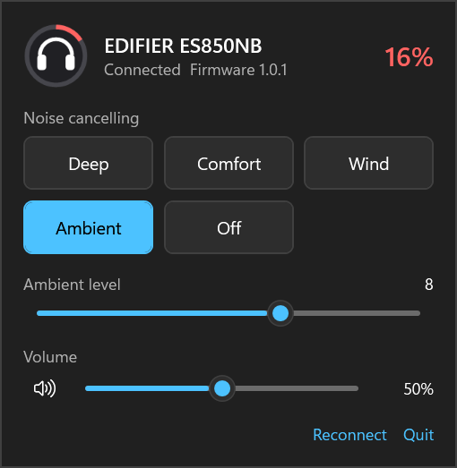
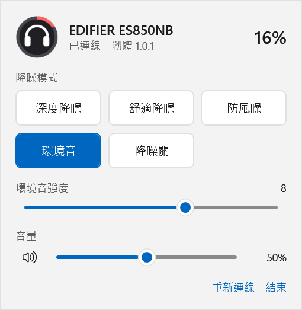
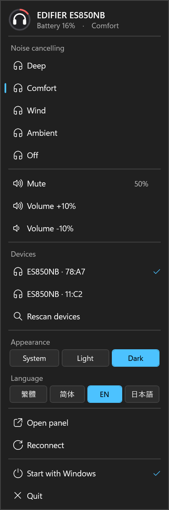
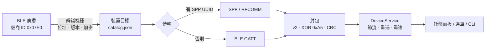

# EdifierReverse

> 在 Windows 上用藍牙控制 Edifier 耳機：逆向官方 App 的通訊協定，做成 Python 函式庫、命令列，以及兩個（Python／C#）托盤小工具。

  

<p align="center">
  
  
  
</p>

Edifier 的進階功能（降噪、音量之外的設定等）只有手機 App 能控制，Windows 沒有官方的藍牙控制工具。這個專案還原了官方 App（ConneX）的通訊協定，讓你在電腦上看電量、切換降噪、調音量。

> [!NOTE]
> 非官方專案，與 Edifier 無關。**目前只有 ES850NB 在實機上驗證過**；其他機種可以被辨識並嘗試連線讀取狀態，但沒有測試，降噪設定也只對已驗證的機型開放。

## 特色

- **托盤常駐**：圖示上的電量環一眼看出電量，左鍵彈出 Windows 11 風格面板，右鍵有常用的快捷選單
- **降噪與音量**：五種降噪模式、環境音強度拖曳條、音量拖曳條與靜音；連按切換時自動冷卻，不會卡住
- **多國語言與外觀**：繁體中文、简体中文、English、日本語；日間／夜間／跟隨系統，即時切換
- **自動辨識 Edifier 裝置**：依官方 App 的判定方式，從 102 個機種的目錄辨識附近的 Edifier 裝置；有多台時可在選單挑選
- **兩種實作**：C#／WPF（主推：原生質感、單一 exe、一鍵安裝、有單例鎖）與 Python（用 uv 啟動，供驗證與開發），功能相同

## 快速開始

需要 Windows 10/11、藍牙，且耳機已在 Windows 配對並連上 A2DP（SPP 控制通道需要）。

### C# 版（主推）

需要 [.NET 8 SDK](https://dotnet.microsoft.com/download)（`winget install Microsoft.DotNet.SDK.8`）。複製專案後擇一：

```powershell
scripts\install.cmd            # 一鍵：建置 → 安裝到 %LOCALAPPDATA%\EdifierTray → 開機自動啟動 → 啟動
scripts\build-installer.ps1    # 或產生 Setup.exe 安裝檔（另需 winget install JRSoftware.InnoSetup）
```

兩者都不需要系統管理員權限。`install.cmd` 可加 `-NoAutostart`、`-NoLaunch`、`-Uninstall`；開機自動啟動也能隨時從托盤右鍵選單開關。細節與實測狀況見 [docs/deployment.md](docs/deployment.md)。

只想編譯：`dotnet build src/EdifierTray -c Release`。

### Python 版（驗證與開發用）

用 [uv](https://docs.astral.sh/uv/) 啟動。不打包、也沒有單例鎖，不建議長期常駐；用途是讓你驗證協定、改程式：

```powershell
uv sync --extra tray
uv run edifier-reverse tray
```

### 命令列

不開托盤也能用（`uv run edifier-reverse <子指令>`）：

| 子指令 | 作用 | 需要藍牙 |
|--------|------|----------|
| `devices` | 列出附近被辨識為 Edifier 的裝置（機種、位址、傳輸方式；只讀） | 是 |
| `status` | 連線並印出名稱、韌體、電量、ANC 狀態（只讀） | 是 |
| `anc <1-5> [--db N]` | 切換降噪模式（會改變耳機狀態；`--db` 1–12 只用於環境音）；自動節流，兩次設定間隔 ≥ 2 秒 | 是 |
| `tray` | 啟動 Python 版托盤小工具 | 是 |
| `scan` / `probe --model <型號>` | 掃描廣播／送出 12 個只讀查詢並記錄（逆向與驗證用） | 是 |
| `sim [--spp]` | 對離線模擬裝置跑一次探測，自測用 | 否 |

C# 版對應：`EdifierTray.exe --cli devices|status|anc N [強度]`。

### 測試

```powershell
uv run pytest                                        # Python：271 個，全部離線，不需要藍牙
dotnet test tests/EdifierTray.Tests -c Release       # C#：102 個
```

## 運作方式



函式庫在 `src/edifier_reverse/`，C# 版在 `src/EdifierTray/`。兩邊共用同一份字串表（`strings.json`）與機種目錄（`catalog.json`），並以相同的測試向量守住協定實作一致。完整的研究結論見 [docs/findings.md](docs/findings.md)。

## 已驗證什麼

| 項目 | ES850NB（實機） | 其他機種 |
|------|----------------|----------|
| 辨識與連線（SPP、BLE） | ✅ | 可辨識，未測試 |
| 電量、名稱、韌體、LDAC 狀態 | ✅ | 只讀查詢逐項容錯，未測試 |
| 降噪五種模式與環境音強度 | ✅ | 只開放已驗證的 group |
| 自訂 EQ 讀寫 | ✅（命令列／函式庫，托盤未開放） | — |
| 音量 | ✅（走 Windows 音訊，非協定） | 同 |

> [!WARNING]
> 絕不送出韌體更新（OTA/DFU）相關指令，函式庫層直接封鎖；只送已在實機上驗證過的指令。

## 專案文件

| 檔案 | 內容 |
|------|------|
| [docs/findings.md](docs/findings.md) | 研究結論總整理（從這裡開始看） |
| [docs/deployment.md](docs/deployment.md) | 安裝檔、一鍵安裝、開機自動啟動與已知缺口 |
| [docs/tool-design.md](docs/tool-design.md) | 托盤小工具設計、兩個版本的比較與實測 |
| [docs/protocol-packet.md](docs/protocol-packet.md)、[protocol-commands.md](docs/protocol-commands.md)、[protocol-d8.md](docs/protocol-d8.md)、[protocol-uuids.md](docs/protocol-uuids.md) | 封包格式、指令 payload、功能旗標、UUID |
| [docs/hq-audio-assessment.md](docs/hq-audio-assessment.md)、[docs/ldac-and-tool-plan.md](docs/ldac-and-tool-plan.md) | 高音質（LDAC／LHDC）評估與工具方案 |
| [docs/handoff-other-pc.md](docs/handoff-other-pc.md) | 換電腦做實機驗證的步驟 |
| [CLAUDE.md](CLAUDE.md) | 給 AI agent 的專案指示 |
| [DEVLOG.md](DEVLOG.md) | 逐步開發紀錄 |

## 參與貢獻

最需要的是**其他機種的實機回報**。有 Edifier 耳機／喇叭的話：

1. `uv run edifier-reverse devices` 看能否被辨識（只讀）。
2. `uv run edifier-reverse status` 看能否連線並讀到電量、名稱（只讀）。
3. 開 issue 附上機種與輸出。**請先遮掉輸出裡的藍牙位址。**

原則：只送已在實機上驗證過的指令；韌體更新（OTA／DFU）指令在函式庫層封鎖，請勿嘗試繞過。協定結論只寫已驗證的事實，並標明推測。改封包、設定規則、字串、機種目錄時，Python 與 C# 兩邊都要改（詳見 [CLAUDE.md](CLAUDE.md)）。

## Roadmap

- [x] 官方 App 靜態分析：UUID、封包格式、指令 payload、機種目錄
- [x] 函式庫與離線測試（BLE／SPP 傳輸、重組、客戶端、模擬裝置）
- [x] ES850NB 實機驗證（連線、查詢、降噪、EQ）
- [x] 托盤小工具（Python 與 C# 兩版）：面板、右鍵選單、語言、外觀、多裝置
- [ ] 真人長時間使用的回饋：常駐穩定性、耳機休眠後重連、手機 App 同時連線的衝突
- [x] 一鍵安裝腳本與 Setup.exe 安裝檔
- [ ] 開機自動啟動的實機驗證（含重新開機）與其已知缺口，見 [docs/deployment.md](docs/deployment.md)
- [ ] 其他機種的實機驗證；C# 版支援 BLE-only 機種（目前請用 Python 版）
- [ ] 在 Android 開 HCI snoop log，錄下官方 App 操作的封包，與反編譯結果對照

## 授權與聲明

程式碼以 [MIT](LICENSE) 授權。本專案為互通性目的的獨立研究：通訊協定由公開可取得的官方 App 分析而來，官方 APK、反編譯原始碼與 HCI 抓包（含裝置位址）**不隨專案散布**（見 `.gitignore`）。機種目錄 `catalog.json` 只含機種名稱、藍牙 UUID 與旗標。Edifier 及相關名稱屬其各自所有者，本專案與其無隸屬關係。
